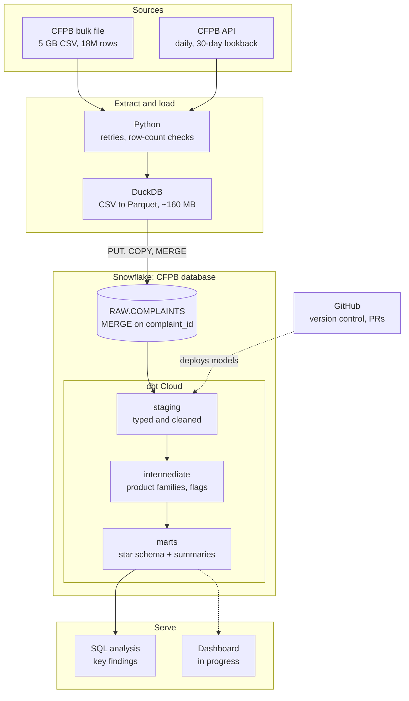
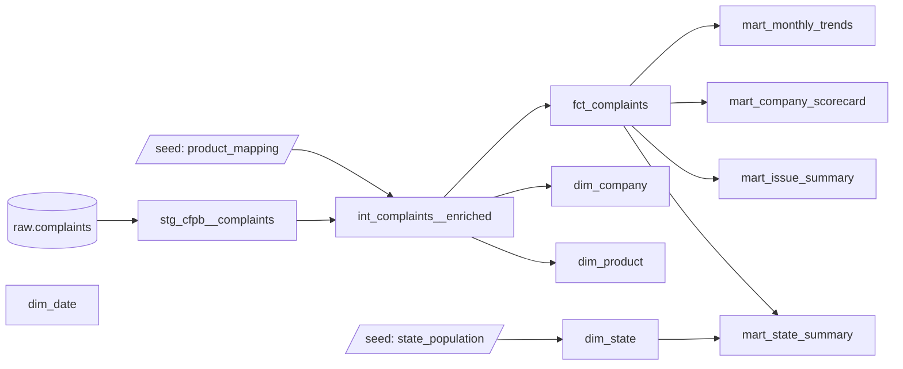

# CFPB Consumer Complaints Analytics


End-to-end ELT pipeline and analysis of the [CFPB Consumer Complaint Database](https://www.consumerfinance.gov/data-research/consumer-complaints/):
**18M consumer complaints** extracted with Python, converted with DuckDB, loaded into Snowflake,
and modeled in dbt Cloud into a tested star schema.

## Key findings

- **Complaints grew 20× in six years** (277K in 2019 to 5.4M in 2025), and the three national credit bureaus now account for 88% of them. Complaints about everyone else still grew 4.8×.
- **Payment apps are the fastest-growing complaint category (16.7×).** The two largest reported relief on 0 of ~65,000 closed complaints in 2024–25, while PayPal reported 29%.
- **Bureau "relief" figures can't be taken at face value.** Experian's relief rate fell from 45% to 0.4% in three years while Equifax's rose from 0% to 64%, which looks like changes in how responses are classified, not real outcomes.
- **Complaints are concentrated in the South.** All top 10 states per resident are Southern; Georgia is 2.4× the national rate and 22× South Dakota.
- **Servicemembers get relief less often** than other consumers in 8 of 11 product families, while older Americans get it more often.

The SQL behind these findings is in [`dbt/analysis/`](dbt/analysis). See [caveats](#caveats) before quoting them.

## Architecture



| Stage | Tool | What happens |
|---|---|---|
| Extract | Python | One-time backfill from the bulk file; daily API pulls re-fetch the last 30 days because companies update responses after filing. Each day's row count is checked against the API's total. |
| Convert | DuckDB | CSVs become compressed Parquet with clean column names (5 GB → ~160 MB in seconds), so the upload to Snowflake is small and loads in parallel. |
| Load | Snowflake | Files are staged, COPYed into a temp table and MERGEd into `RAW.COMPLAINTS` on `complaint_id`, so reloads never create duplicates. Every load is logged in `RAW.LOAD_LOG`. |
| Transform | dbt Cloud | Staging → intermediate → star schema and summary marts, with 49 data tests. |
| Secure | Snowflake roles | Separate loader and transformer roles; service users authenticate with key pairs, not passwords. |

## Data model



- **`fct_complaints`** (18M rows): one row per complaint, with keys to `dim_company` (8,130 companies), `dim_product` (127 product/sub-product pairs), `dim_state` (63 codes with 2025 Census population) and `dim_date`.
- **Product mapping seed:** the CFPB renamed its product categories in 2017 and 2023, so 21 product names are mapped to 12 stable product families.
- **Summary marts** store counts, not rates, so percentages stay correct at any level of grouping in a dashboard.

### Data quality

`dbt build`: 11 models, 2 seeds, 49 data tests (all passing; 1 expected warning).

- Unique and not-null keys on every dimension and the fact table
- Relationship tests from every fact key to its dimension
- Accepted-values tests on response types, relief outcomes, submission channels and consumer groups
- A reconciliation test that fails if any summary mart doesn't add back up to the fact table
- A warning-level test for ~7K historical complaints whose sent-to-company date precedes the received date (a source data quirk)

## Project structure

| Path | What it holds | Status |
|---|---|---|
| [`extract_load/`](extract_load) | Python extract (`bulk.py`, `api.py`) and loaders (`load_duckdb.py`, `load_snowflake.py`) | Done |
| [`snowflake/`](snowflake) | One-time setup SQL (warehouse, roles, service users, stage, raw tables) and key-pair script | Done |
| [`dbt/`](dbt) | dbt project run in dbt Cloud: seeds, models, tests, macros | Done |
| [`dbt/analysis/`](dbt/analysis) | SQL behind the key findings | Done |
| `dashboard/` | Interactive dashboard on the summary marts | Next |
| `.github/workflows/` | Scheduled extract → load → `dbt build` | Planned |
| `data/` | Local landing zone (git-ignored) | — |

## Run it yourself

### 1. Setup

```bash
./setup.sh                  # creates .venv, installs requirements, copies .env.example -> .env
source .venv/bin/activate
```

### 2. Extract

```bash
# One-time backfill: full bulk file (~330 MB zip, ~5 GB CSV, ~18M rows) -> data/raw/
python -m extract_load.bulk

# Incremental API pull -> data/landing/api/date_received=YYYY-MM-DD.csv
python -m extract_load.api --start 2026-09-01   # first run
python -m extract_load.api                      # later runs: watermark minus 30-day lookback
```

`api.py` uses the API's `format=csv` export (same 15 columns as the bulk file; the JSON
endpoint caps results at 10,000 rows). `date_received_max` is inclusive, so each request
covers exactly one day. Files are overwritten per day, so reruns are safe.

### 3. Snowflake setup (once)

1. In a Snowsight worksheet, as ACCOUNTADMIN, run [`snowflake/setup.sql`](snowflake/setup.sql).
2. Generate key pairs for the two service users and run the printed `ALTER USER` statements in Snowsight:
   ```bash
   ./snowflake/make_keys.sh
   ```
3. In `.env`, set `SNOWFLAKE_ACCOUNT` (Snowsight > profile menu > *Connect a tool to Snowflake*).

### 4. Load

```bash
python -m extract_load.load_snowflake          # bulk file + all API files -> CFPB.RAW.COMPLAINTS
python -m extract_load.load_snowflake api      # only API files
```

For local development without Snowflake, `python -m extract_load.load_duckdb` loads the same
files into `data/cfpb.duckdb` with the same upsert logic.

### 5. Transform

In dbt Cloud: connect this repo, set the **project subdirectory** to `dbt`, and use a Snowflake
connection with user `CFPB_DBT_SVC`, role `CFPB_TRANSFORMER`, warehouse `CFPB_WH`, database `CFPB`
and key-pair auth (`~/.snowflake/cfpb_dbt_key.p8`). Then run:

```
dbt build
```

## Roadmap

- [ ] **Dashboard** on the summary marts: complaint trends, company scorecard, state map
- [ ] **Orchestration:** scheduled GitHub Actions run of extract → load → `dbt build`
- [ ] **dbt snapshots** of complaint status, to measure how long companies take to close complaints

## Caveats

- A complaint is not proof of wrongdoing, and the CFPB does not verify every claim.
- Larger companies receive more complaints partly because they have more customers; compare rates, not raw counts.
- Relief figures reflect how each company classifies its responses (see the bureau finding above).
- Per-resident rates use 2025 Census population estimates for every year.
- Mapping the 2017 and 2023 product renames into 12 families involved judgment calls, documented in [`product_mapping.csv`](dbt/seeds/product_mapping.csv).

## Data source

[CFPB Consumer Complaint Database](https://www.consumerfinance.gov/data-research/consumer-complaints/),
published by the Consumer Financial Protection Bureau under a CC0 public-domain license.
Population estimates: U.S. Census Bureau, NST-EST2025.
